  

# 🌐 Awesome Desktop API Proxy & Agent

  
  
  
  
  

  <b>A curated catalog of premier SaaS platforms and battle-tested open-source desktop proxies, HTTP/HTTPS interceptors, secure reverse tunnels, and local API developer agents.</b>

---

## 📑 Table of Contents

- [📊 Sector Overview & Market Dynamics](#-sector-overview--market-dynamics)
- [☁️ SaaS & Hosted Platforms](#️-saas--hosted-platforms)
- [🔓 Open-Source GitHub Projects](#-open-source-github-projects)
- [💡 Key Use Cases & Selection Guide](#-key-use-cases--selection-guide)
- [🤝 How to Contribute](#-how-to-contribute)
- [⭐ Star History](#-star-history)
- [💖 Support](#-support)
- [📜 Disclaimer](#-disclaimer)

---

## 📊 Sector Overview & Market Dynamics

The developer connectivity, API debugging proxy, and edge tunneling tooling market is estimated at **$2.8B to $4.2B USD**, driven by the explosion of microservices, webhooks, distributed cloud topologies, and mobile/hybrid application development. The sector exhibits **moderate fragmentation with specialized sub-segment concentration**: enterprise API client workflows are dominated by heavyweight consolidation (e.g., Postman), while developer reverse tunneling is spearheaded by category leaders like ngrok and Cloudflare; simultaneously, deep protocol manipulation, penetration testing (DAST), and local-first HTTPS proxying remain vigorously contested by enduring desktop software (Proxyman, Charles, Fiddler) and foundational open-source utilities (frp, mitmproxy, ZAP).

---

## ☁️ SaaS & Hosted Platforms

*Below is a comprehensive breakdown of top-tier desktop API proxy and agent solutions sorted by organizational valuation / parent market capitalization in descending order.*

| Product | Company Scale / Valuation | Description | Starting Pricing | Free Tier / Trial Limits |
|:---|:---|:---|:---|:---|
| **[Postman Desktop Agent](https://www.postman.com/downloads/)** | **~$5.6B Valuation** *(Enterprise Scale)* | 🚀 Native cross-platform desktop agent bridging web browsers to local network ports, removing CORS limitations for web clients and enabling local REST, GraphQL, WebSocket, gRPC, and MQTT introspection. | **$14/user/month** *(Basic plan billed annually; agent itself bundled free)* | **Free Forever**: Includes up to 3 team members, full desktop agent capabilities, and 1,000 cloud API calls/month. |
| **[ngrok](https://ngrok.com/)** | **~$500M+ Valuation** *(Category Leader, Series B)* | 🌐 High-performance secure ingress reverse tunnel agent establishing instant public HTTPS/TCP/TLS endpoints to local development machines for webhooks, preview URLs, and remote mobile device testing. | **$20/month** *(Pay-as-you-go base with $20 usage credit included; additional endpoint hours billed separately)* | **Free Tier**: 1 user, 1 static domain, up to 3 simultaneous endpoints, and 1 GB/month data transfer. |
| **[Fiddler Everywhere](https://www.telerik.com/fiddler)** | **~$400M+ Parent Valuation** *(Progress Software, NASDAQ: PRGS)* | 🛠️ Modern cross-platform HTTP/HTTPS network debugging proxy featuring automated traffic modification rules, SSL decryption, mock responses, and team collaboration workflows. | **$7/user/month** *(Lite plan billed annually at $84/year; Pro plan at $13/user/month)* | **Lite Free Plan & Trial**: 10-day full-featured commercial trial; Lite tier offers constrained traffic capture and limited rules. |
| **[Proxyman](https://proxyman.com/)** | **$10M–$25M Est. Valuation** *(Bootstrapped Market Leader)* | ⚡ Ultra-fast native macOS, Windows, and Linux HTTPS debugging proxy with companion iOS/Android interception apps, Map Local/Remote, scriptable rules, and SSL pinning bypass. | **$79 one-time** *(Standard license with 1-year updates; iOS Premium from ~$9.99/year)* | **Free Forever Trial**: Unlimited duration for personal use (limited to 2 pinned domains and 2 rules per tool); 14-day fully unrestricted commercial trial. |
| **[Charles Proxy](https://www.charlesproxy.com/)** | **$5M–$15M Est. Valuation** *(Established Independent)* | 🔍 Canonical cross-platform Java-based HTTP monitor and reverse proxy with SSL certificate generation, AMF/binary inspection, bandwidth throttling simulation, and W3C validation. | **$50 one-time** *(Single user commercial license for Charles v5)* | **30-Day Free Trial**: 30-minute operational time limit per session accompanied by delay nag-screens. |
| **[LocalXpose](https://localxpose.io/)** | **$2M–$5M Est. Valuation** *(Independent Scale)* | 🔒 Reverse proxy tunneling utility supporting HTTP, HTTPS, TCP, and UDP forwarding with client GUI, built-in let's encrypt TLS, and team token authentication. | **$8/month** *(Pro plan billed annually at $96/year; or $10 billed monthly)* | **Starter Free Plan**: 2 active tunnels, randomized subdomains, TLS/SSL encryption, and 1 GB bandwidth. |

---

## 🔓 Open-Source GitHub Projects

*The open-source ecosystem provides transparent, scriptable, self-hostable, and zero-telemetry alternatives for HTTP interception, security analysis, and local-to-edge tunneling. Sorted in descending order by GitHub Stars.*

| Project | GitHub Stars | Description | Focus Area |
|:---|:---:|:---|:---|
| **[frp](https://github.com/fatedier/frp)** |  | ⚡ Extremely fast, production-grade reverse proxy written in Go to expose local NAT/firewalled servers to public networks via TCP, UDP, HTTP, and HTTPS. | Edge Tunneling & Ingress |
| **[mkcert](https://github.com/FiloSottile/mkcert)** |  | 📜 Zero-configuration command-line utility for generating locally trusted SSL/TLS development certificates in OS root trust stores. | Local HTTPS & PKI |
| **[mitmproxy](https://github.com/mitmproxy/mitmproxy)** |  | 🐍 The premier interactive, SSL/TLS-capable intercepting proxy for HTTP/1, HTTP/2, and WebSockets. Provides full terminal UI, web console, and scriptable Python addon API. | Traffic Interception & MITM |
| **[localtunnel](https://github.com/localtunnel/localtunnel)** |  | 🌍 Open-source Node.js client exposing local localhost ports to public URLs without forwarding ports or reconfiguring firewalls. | Dev Webhooks & Preview |
| **[goproxy](https://github.com/snail007/goproxy)** |  | 🚀 High-performance multi-protocol proxy server supporting HTTP, HTTPS, SOCKS5, Shadowsocks, TCP/UDP port forwarding, and TLS proxying. | Multi-Protocol Proxy |
| **[chisel](https://github.com/jpillora/chisel)** |  | 🧱 Fast TCP/UDP tunnel transported over HTTP, secured via SSH. Single standalone binary for cross-platform NAT traversal and secure port forwarding. | Secure TCP/UDP Tunneling |
| **[cloudflared](https://github.com/cloudflare/cloudflared)** |  | ☁️ Official open-source client for Cloudflare Tunnel (Argo). Seamlessly routes traffic from Cloudflare's global edge to local origins without public IPs. | Edge Ingress & Zero Trust |
| **[OWASP ZAP](https://github.com/zaproxy/zaproxy)** |  | 🛡️ The world's most widely deployed open-source DAST penetration testing proxy. Intercepts web requests, automates active/passive vulnerability scanning, and integrates into CI/CD. | AppSec & Penetration Testing |
| **[rathole](https://github.com/rapiz1/rathole)** |  | 🦀 Lightweight, high-throughput reverse proxy for NAT traversal written in Rust, optimized for low memory overhead and high concurrency. | High-Speed Rust Ingress |
| **[Mockoon](https://github.com/mockoon/mockoon)** |  | 🎭 Local-first, zero-telemetry desktop application and CLI to mock and proxy HTTP APIs locally with automated rules, regex route matching, and proxy mode. | API Mocking & Proxying |
| **[gost](https://github.com/go-gost/gost)** |  | 🧩 Go Simple Tunnel — highly versatile proxy chain engine supporting multi-level forwarding, TLS/mTLS, QUIC, KCP, and Shadowsocks. | Complex Proxy Chains |
| **[Requestly](https://github.com/requestly/requestly)** |  | 🎛️ Local-first developer client combining HTTP request/response interception, Map Local/Remote redirects, mock headers, and API client capabilities. | API Testing & Interception |
| **[sish](https://github.com/antoniomika/sish)** |  | 💻 Open-source alternative to ngrok using pure SSH. Exposes HTTP(S), WebSockets, and TCP tunnels to localhost using existing SSH client keys. | SSH-Driven Tunneling |
| **[HTTP Toolkit](https://github.com/httptoolkit/httptoolkit)** |  | 🧰 Beautiful open-source desktop proxy app for Windows, macOS, and Linux that intercepts, inspects, and mocks HTTP(S) traffic with 1-click targeted interception. | Desktop HTTPS Inspector |
| **[Proxify](https://github.com/projectdiscovery/proxify)** |  | 🔎 Swiss Army knife proxy tool for capturing, manipulating, and replaying HTTP/HTTPS and TCP traffic with native upstream chaining and ElasticSearch logging. | Security & Traffic Dumper |
| **[SirTunnel](https://github.com/anderspitman/sirtunnel)** |  | 🪶 Minimalist zero-config alternative to ngrok leveraging Caddy and OpenSSH in ~50 lines of Python code for secure custom domain tunneling. | Minimalist Tunneling |
| **[Inspectr](https://github.com/inspectr-hq/inspectr)** |  | 📡 Lightweight desktop API request inspector with live traffic capture, webhook monitoring, and OpenAPI-based mock simulation. | Frontend API Debugging |

---

## 💡 Key Use Cases & Selection Guide

- **Mobile Application Debugging & SSL Decryption**: Choose **[Proxyman](https://proxyman.com/)** or **[mitmproxy](https://github.com/mitmproxy/mitmproxy)** for streamlined CA certificate provisioning on iOS/Android devices and live scriptable traffic diffing.
- **Webhook Testing & Third-Party Integrations**: Deploy **[ngrok](https://ngrok.com/)**, **[cloudflared](https://github.com/cloudflare/cloudflared)**, or **[frp](https://github.com/fatedier/frp)** to immediately establish reliable public endpoints to local developer ports.
- **Automated Security & CI/CD DAST Auditing**: Integrate **[OWASP ZAP](https://github.com/zaproxy/zaproxy)** into deployment pipelines for automated passive and active vulnerability detection.
- **Local API Mocking & Frontend Redirects**: Utilize **[Mockoon](https://github.com/mockoon/mockoon)** or **[Requestly](https://github.com/requestly/requestly)** to simulate missing backend endpoints and redirect production bundles locally.

---

## 🤝 How to Contribute

Contributions, project submissions, and suggestions are welcome!

1. 🍴 **Fork** this repository.
2. 🌿 Create a feature branch: `git checkout -b feature/new-tool`.
3. 📝 Add your tool to the relevant table in **alphabetical or star order**, including name, GitHub repository or official site, description, pricing details, and star badges.
4. 🚀 Push changes and open a **Pull Request**.

---

## ⭐ Star History

---

## 💖 Support

If this curated repository saved you debugging hours or simplified your local development workflow, please consider showing your support:

- ⭐ **Star** this repository to make it more discoverable for the developer community.
- 🍴 **Fork** and share it with your engineering team and colleagues.
- ☕ **Buy a Coffee / Sponsor**: Support ongoing maintenance and curation on the [Sponsor Dashboard](https://github.com/sponsors/ishandutta2007).

---

## 📜 Disclaimer

- This catalog is a community-curated technical resource and does not imply endorsement of any commercial product or open-source software.
- Intercepting network traffic carries significant security and compliance obligations. Always obtain authorization before inspecting or modifying data in non-local environments, and securely decommission local root certificates following testing sessions.
